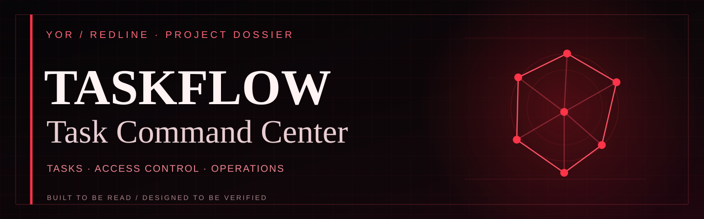
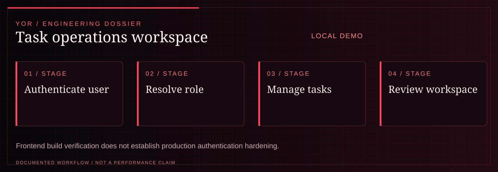

<!-- YOR REDLINE / README COVER V1 -->
<div align="center">

<picture><source media="(max-width: 600px)" srcset="docs/yor-redline-cover-mobile.svg"/></picture>

<sub><strong>YOR / PROJECT DOSSIER</strong> · <a href="https://github.com/yorayriniwnl">GitHub</a> · <a href="https://yorayriniwnl.in">Portfolio</a></sub>

</div>
<!-- END YOR REDLINE -->

# YOR // TaskFlow

TaskFlow is an API-backed task workspace with JWT authentication, role-based access control, task CRUD, profiles, and an admin surface. The frontend keeps the existing route model while presenting it as a YOR command deck: black field, graphite panels, crimson actions, signal annotations, and evidence-led status language.

<!-- YOR REDLINE / EXPERIENCE V2 -->

<a id="system-map"></a>
## System map

<div align="center"><picture><source media="(max-width: 600px)" srcset="docs/yor-redline-system-mobile.svg"/></picture></div>

| Project signal | Documented scope |
| :--- | :--- |
| **Current maturity** | LOCAL DEMO |
| **Technical focus** | JWT authentication, role-based access control, task CRUD, profiles, and admin interface. |
| **Evidence boundary** | Frontend build verification does not establish production authentication hardening. |

**Navigate:** [Evidence boundary](#evidence-boundary) · [Local verification](#local-verification) · [Visual contract](#visual-contract) · [Scope notes](#scope-notes)

<!-- END YOR REDLINE / EXPERIENCE V2 -->

## Evidence boundary

| Surface | Status | Evidence boundary |
| --- | --- | --- |
| Vite frontend build and route packaging | VERIFIED | `frontend/npm run build` completes against the checked-in source. |
| YOR visual token checker | VERIFIED | `frontend/npm run design:check` checks the canonical palette and field gradient. |
| Login/register/dashboard/task/profile/admin UI | DEMO | UI routes and forms are present; a live account/database is required for end-to-end use. |
| Express API, JWT, RBAC, validation, and PostgreSQL wiring | REPORTED | The implementation and route structure are in source; provider-backed behavior needs configured services. |
| Docker/PostgreSQL deployment | UNVERIFIED | No deployment or hosted database claim is made by this repository pass. |
| Production observability, migrations, and operational hardening | PLANNED | Treat before public launch. |

## Local verification

```powershell
cd frontend
npm ci
npm run design:check
npm run build
```

The backend is a separate Express service under `backend/` and expects the environment in `backend/.env.example`. Do not place live credentials in the repository. The demo credentials shown by the UI are local-development hints, not a production access policy.

## Visual contract

- Void `#000000`, graphite `#050505`, crimson `#e84b4b`, deep crimson `#671515`
- Signal `#ff8a7f`, warm white `#f5eaea`, muted `#c4c4c4`
- Field gradient `#671515 → #8c1616 → #2a0505`
- Square controls, visible focus states, responsive shell, grid/noise field, reduced-motion fallback

## Scope notes

The repository remains a task-workspace implementation, not a claim of hosted availability or production readiness. Verify database connectivity, migrations, email/session policy, rate limits, and deployment configuration independently before launch.
